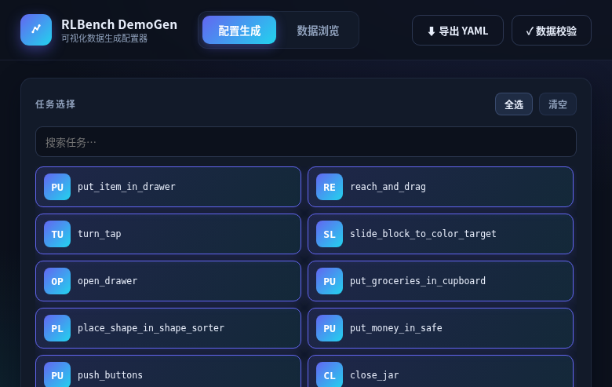
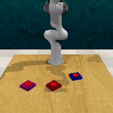

# RLBench DemoGen — 可视化数据生成工具

在浏览器里点选任务、预览真渲染效果、一键生成 RLBench 操作演示数据集（5 相机 RGB-D + 语言指令），也可纯命令行运行。Docker 一条命令装好全部环境。



训练闭环实拍：生成数据 → LeRobot 导出 → 微调 ACT → 仿真回放（60% 成功率，[训练教程](docs/train-act.md)）：



## 特点

- **可视化操作**：任务点选 / 参数滑杆 / 仿真器真渲染预览 / 进度与日志实时展示 / 任务一键中断
- **安装快捷**：`./build.sh` 一条命令装好 CoppeliaSim/PyRep/RLBench，免踩坑、不污染系统
- **数据浏览**：内置查看器，逐集浏览 RGB / 深度色带 / 掩码，时间轴回放
- **生成引擎**：并行采集、断点续传、随机种子落盘、16-bit 毫米深度、相机内外参、完整性校验
- **数据兼容**：PerAct / RVT / SAM2Act 布局，可直接训练 ACT、Diffusion Policy、OpenVLA 等模型
- **多版本共存**：CoppeliaSim / RLBench / PyRep 版本 build-arg 自由组合，镜像按 tag 并存

## 适用场景

- 为模仿学习 / VLA 模型生成训练数据（含 RLBench 18 任务基准集）
- 生成前直观确认任务/变体长相，避免盲目跑批
- 教学演示与实验课：镜像分发，学生零安装
- CI / 自动化流水线（全无头、可脚本化）

## 对比同类工具

| | RLBench DemoGen | Isaac Lab | ManiSkill3 | robosuite |
|---|---|---|---|---|
| 安装 | Docker 一条命令 | Omniverse 全家桶 | pip + 多项配置 | pip |
| GPU | 不需要 | 需要 | 推荐 | 不需要 |
| 可视化配置 / 真渲染预览 | ✅ | GUI 场景编辑 | ✗ | ✗ |
| 演示数据生成 | ✅ 脚本专家 | ✗（需自写） | ✗（需自写） | ✗（需自写） |
| LeRobot 格式导出 | ✅ 一键 | ✗ | ✗ | ✗ |
| 上手时间 | ~10 分钟 | 数小时 | 数小时 | 数小时 |

## English

**RLBench DemoGen** — a visual dataset factory for robot manipulation learning:
pick tasks in the browser, preview with real simulator rendering, generate
multi-view RGB-D demonstrations with language annotations, and export them to
**LeRobot** format ready for ACT / Diffusion Policy training. One-command Docker
setup, no GPU required for data generation.
[Quick start](#快速开始web-可视化) · [LeRobot export](docs/lerobot-export.md) ·
[Train tutorial](docs/train-act.md)

## 使用环境

| 操作系统 | Docker | 磁盘 | 内存 | 浏览器 | GPU / 显示器 | 网络 |
|---|---|---|---|---|---|---|
| Ubuntu 20.04 / 22.04 **x86_64** | ≥ 24 + compose 插件 | ≥ 20GB | ≥ 8GB（推荐 16GB） | Chrome / Firefox | 不需要 | 仅构建时 |

实测：Ubuntu 22.04 + Docker 29.8.1。不支持 ARM。

## 快速开始（Web 可视化）

```bash
./build.sh                 # 1. 构建（自动下载 62MB 安装包 + 构建镜像）
docker compose up -d       # 2. 启动 Web 服务
```

浏览器打开 **http://localhost:8000**：

1. **配置生成**：勾选任务（默认清空，可一键全选 18 任务基准集）→ 调参数 →
   点「渲染预览」看真渲染效果 → 「▶ 开始生成」→ 右侧看进度日志，可随时「■ 中断」；
2. **数据浏览**：选任务/episode → 切换 RGB / 深度 / 掩码与相机 → 时间轴回放；
3. **数据导出**：选动作空间/状态预设/相机/分辨率 → 「▶ 开始导出」→ 产出
   LeRobot v2.1 数据集到 `output/lerobot/`（详见 [docs/lerobot-export.md](docs/lerobot-export.md)）；
4. 顶栏「⬇ 导出 YAML」保存配置，「✓ 数据校验」一键完整性检查。

数据输出在 `./output/`。深度为 magma 色带（近暖远冷），掩码按实例着色。

## 命令行用法（同镜像，等价于界面）

```bash
docker compose run --rm demogen generate \
  --tasks reach_and_drag --episodes 25 --workers 2         # 生成
docker compose run --rm demogen verify /data               # 校验
docker compose run --rm demogen generate --help            # 全部参数
```

| 参数 | 默认 | 说明 |
|---|---|---|
| `--tasks` | `all18` | 逗号分隔任务名 / `all18` / `all`（107+ 任务全集） |
| `--episodes` | 25 | 每任务集数 |
| `--image-size W H` | 128 128 | 相机分辨率 |
| `--workers` | 1 | 并行数（每 worker 一个 CoppeliaSim 实例） |
| `--seed` | 42 | 随机种子（每集种子落盘） |
| `--layout` | `all_variations` | PerAct/RVT/SAM2Act 兼容布局 |
| `--overwrite` | 关 | 默认断点续传，跳过完整集 |

数据格式与动作推导（供训练用）：[docs/data-format.md](docs/data-format.md)。

## 导出为 LeRobot 格式

```bash
docker compose run --rm demogen convert --src /data --out /data/lerobot --name my_dataset
```

一步产出 HuggingFace LeRobot v2.1 标准数据集（parquet + h264 视频 + 统计），
可直接喂 ACT / Diffusion Policy 训练。动作空间预设
（`eef-pose` / `eef-delta` / `joint`）、相机与分辨率可选，详见
[docs/lerobot-export.md](docs/lerobot-export.md)。

## 发展路线

数据工厂增长计划（格式出口 → 训练闭环 → 可视化合成 → 声量）：
[docs/plan-growth.md](docs/plan-growth.md)。

## 基准任务补全（18 任务基准集需要）

官方 RLBench 没有 3 个 PerAct/SAM2Act 基准任务变体
（`slide_block_to_color_target`、`place_wine_at_rack_location`、`sweep_to_dustpan_of_size`），
从你自己的 SAM2Act/PerAct 安装一键补全（学术用途，见 [THIRD_PARTY_NOTICES.md](THIRD_PARTY_NOTICES.md)）：

```bash
./add-benchmark-tasks.sh ~/Project/EmbodiedAI/sam2act/sam2act/libs/RLBench
./build.sh
```

只需补一次。不补全时其余 107 个官方任务（含基准集的 15 个）均可正常使用。

## 下载说明

**用户只需 Docker。** 以下组件构建时自动获取（链接供手动备用）：

| 组件 | 方式 | 链接 |
|---|---|---|
| CoppeliaSim Player **4.1**（~62MB） | `./build.sh` 主机侧下载（断点续传）；手动：任意下载工具存为 `docker/coppeliasim.tar.xz` | [直链](https://downloads.coppeliarobotics.com/V4_1_0/CoppeliaSim_Player_V4_1_0_Ubuntu20_04.tar.xz) · [历史版本](https://www.coppeliarobotics.com/previousversions) |
| PyRep 4.1.x | 构建时自动 clone（5 次重试） | https://github.com/stepjam/PyRep |
| RLBench 1.2.x | 构建时自动 clone（5 次重试） | https://github.com/stepjam/RLBench（**仅限学术非商业**） |
| 现成 18 任务数据集（可选） | 手动 | [huggingface.co/datasets/hqfang/rlbench-18-tasks](https://huggingface.co/datasets/hqfang/rlbench-18-tasks)（镜像 `hf-mirror.com`） |

⛔ CoppeliaSim 勿用 4.2+（API 不兼容）。

## 网络受限

```bash
./download-coppeliasim.sh            # 反复重跑续传；更慢时浏览器/迅雷下载后放 docker/coppeliasim.tar.xz
DEMOGEN_GH_MIRROR=https://ghfast.top/ ./build.sh    # GitHub 镜像加速（build.sh 会自动探测并切换）
docker compose build --build-arg GITHUB_MIRROR=https://ghfast.top/   # 等价手动形式
docker compose build --build-arg HTTPS_PROXY=http://127.0.0.1:7890 --build-arg HTTP_PROXY=http://127.0.0.1:7890
```

GitHub 直连/SSH 慢时（常见），用 `GITHUB_MIRROR` 走代理镜像（实测 `ghfast.top`
45 秒可克隆 93MB，直连同期停滞）；`GIT_DEPTH=0` 可恢复全量克隆（默认浅克隆）。

## 故障排查

| 现象 | 处理 |
|---|---|
| 渲染段错误，栈含 `COpenglOffscreenC` / `QOpenGLContext` | 勿删 Dockerfile 里的 `QT_PLUGIN_PATH=/opt/coppeliasim` |
| CoppeliaSim 下载慢/中断 | 见"网络受限"，断点续传或换工具 |
| build 报 git clone 超时 | 换镜像地址或加代理（已内置 5 次重试） |
| `docker: permission denied` | `sudo usermod -aG docker $USER` 后重新登录 |
| 容器内 bus error | 勿删 compose 里的 `shm_size: 4gb` |
| verify 报帧数不符 | 该集生成中断，重跑同一 generate 命令自动续传 |

## 多版本支持

```bash
docker build -f docker/Dockerfile --build-arg PYREP_REF=<commit> --build-arg RLBENCH_REF=<commit> -t rlbench-demogen:<tag> .
```

CoppeliaSim 换 4.1.x 小版本：替换 `docker/coppeliasim.tar.xz` 后重建。

## 目录

```
├── build.sh / download-coppeliasim.sh / add-benchmark-tasks.sh
├── docker/Dockerfile + entrypoint.sh     # 一键环境（serve/generate/verify/bash）
├── docker-compose.yml (+ gpu 变体)
├── scripts/generate.py + verify.py       # 生成引擎与校验
├── web/                                  # 可视化界面（FastAPI + 原生前端，无 CDN 依赖）
├── tasks_extra/                          # 基准任务补全区（默认空）
├── docs/data-format.md                   # 数据格式规范
└── docs/legal-compliance.md              # 法律合规说明
```

## ⚠️ 法律与使用限制

本仓库仅含原创代码，不含 RLBench / PyRep / CoppeliaSim 源码；构建时由用户自行
下载并接受其许可。**RLBench 仅限非商业学术研究**（Imperial College 许可，不可
转让/再授权）；CoppeliaSim 禁止再分发二进制（镜像勿 push 公共 registry）。
详见 [docs/legal-compliance.md](docs/legal-compliance.md)、[THIRD_PARTY_NOTICES.md](THIRD_PARTY_NOTICES.md)。

## 致谢

数据生成基于 [RLBench](https://github.com/stepjam/RLBench)（Imperial College
London）与 [PyRep](https://github.com/stepjam/PyRep)，仿真器为
[CoppeliaSim](https://www.coppeliarobotics.com/)；数据布局与 PerAct / RVT /
SAM2Act 生态兼容。
